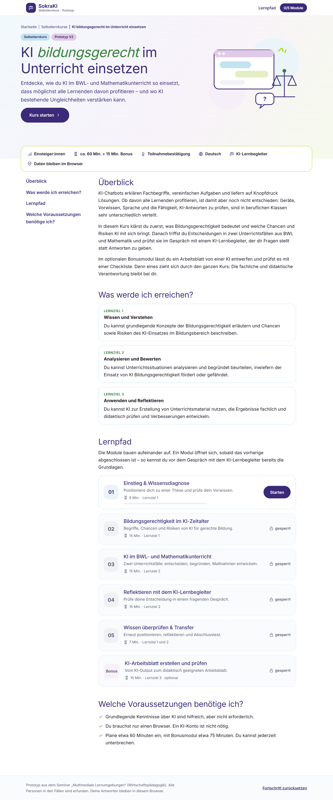
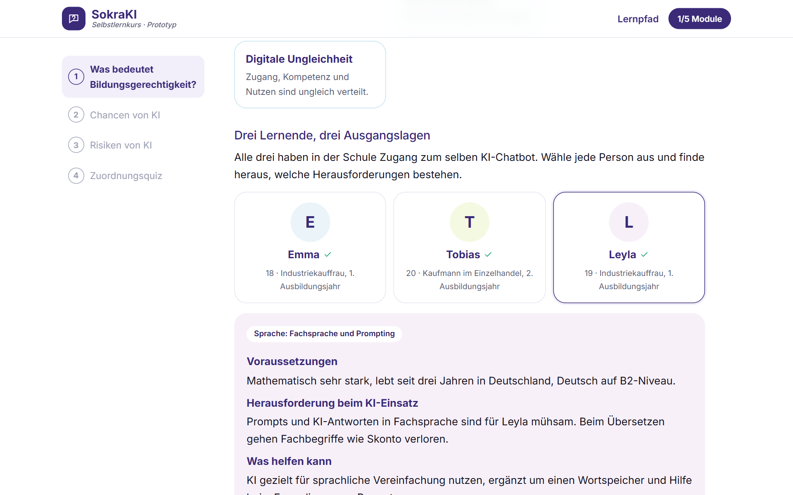
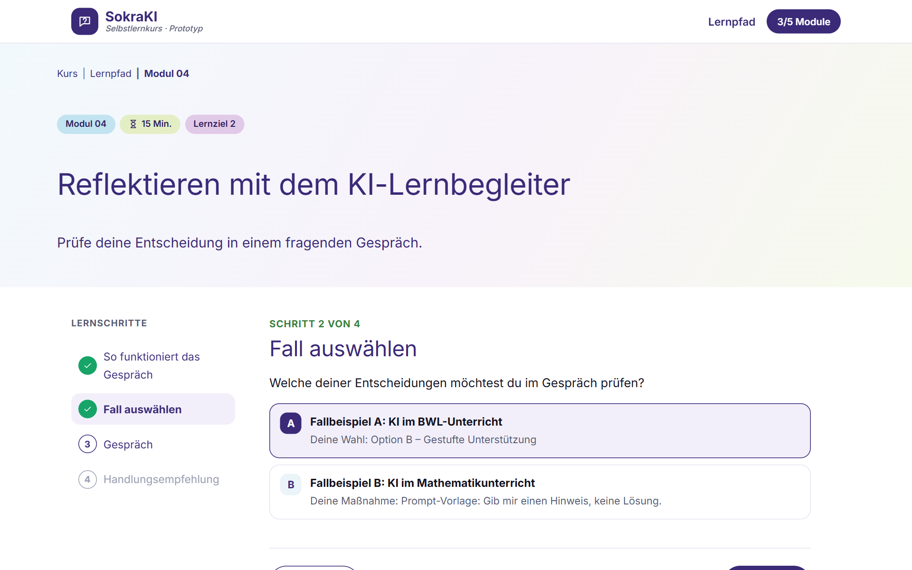

# KI bildungsgerecht im Unterricht einsetzen – SokraKI V2

**Ein interaktiver Selbstlernkurs für angehende Lehrkräfte an beruflichen Schulen.**
Prototyp aus dem Seminar *Multimediale Lernumgebungen* (Wirtschaftspädagogik). Bearbeitungsdauer: ca. 65 Minuten, mit Bonusmodul ca. 85 Minuten.



---

## Schnellstart in 5 Schritten

Du brauchst keine Programmierkenntnisse. Rechne beim ersten Mal mit etwa 10 Minuten.

### 1. Node.js installieren (einmalig)

Lade Node.js in der Version **LTS** von [nodejs.org](https://nodejs.org/de) herunter und installiere es mit den Standardeinstellungen (mindestens Version 20.9). Öffne danach ein **neues** Terminal und prüfe:

```bash
node -v
```

> **Terminal öffnen:** Unter Windows im Startmenü „Eingabeaufforderung“ suchen, unter macOS das Programm „Terminal“ öffnen.

### 2. Projekt herunterladen

**Mit Git:**

```bash
git clone https://github.com/1MauriceWolfrum-tech/SokraKI-V2.git
```

```bash
cd SokraKI-V2
```

**Ohne Git:** Auf [github.com/1MauriceWolfrum-tech/SokraKI-V2](https://github.com/1MauriceWolfrum-tech/SokraKI-V2) auf **Code → Download ZIP** klicken, entpacken und im Terminal in den Ordner wechseln, zum Beispiel `cd Downloads/SokraKI-V2-main`.

### 3. Abhängigkeiten installieren (einmalig, ca. 1 Minute)

```bash
npm install
```

### 4. Kurs starten

```bash
npm run dev
```

### 5. Im Browser öffnen

Öffne **[http://localhost:3000](http://localhost:3000)**. Beenden mit **Strg + C** im Terminal.

> **Port 3000 belegt?** `npm run dev -- -p 3001` und `http://localhost:3001` öffnen.

---

## Aufbau des Kurses

| Modul | Titel | Dauer | Lernziel |
| --- | --- | --- | --- |
| 01 | Einstieg & Wissensdiagnose | 8 Min. | Vorwissen aktivieren, Position zur Ausgangsthese |
| 02 | Bildungsgerechtigkeit im KI-Zeitalter | 18 Min. | Begriffe, was Lehrkräfte über KI wissen sollten (Kernrisiken, Digital Divide, angemessenes Vertrauen), Chancen, Risiken, Zuordnungsquiz |
| 03 | KI im BWL- und Mathematikunterricht | 15 Min. | Fall A: entscheiden und Begründungen auswählen, Reflexionsquiz. Fall B: zwei Chats nach Merkmalen des sokratischen Dialogs vergleichen, Handlungsempfehlung mit Musterlösung |
| 04 | Reflektieren mit dem KI-Lernbegleiter | 18 Min. | Was einen sokratischen Dialog ausmacht, Quiz „Sokratisch oder nicht?“, Gespräch in fünf Phasen mit Antwortbausteinen, Musterlösung |
| 05 | Wissen überprüfen & Transfer | 7 Min. | Erneute Positionierung, Erkenntnisse auswählen, eine Transferfrage, Abschlusstest, Feedback |
| Bonus | KI-Arbeitsblatt erstellen und prüfen | 20 Min. | Arbeitsblatt sokratisch planen, Prompt mit Chain of Thought, Entwurf prüfen, verbessern und als PDF drucken |

Die Module schalten sich nacheinander frei. Nach Modul 05 gibt es eine druckbare Teilnahmebestätigung; das Bonusmodul ist optional.

Die Seite **Nachschlagen** (oben in der Navigation) ist jederzeit erreichbar. Sie enthält eine Anleitung für den sokratischen Dialog mit KI mit Prompts zum Kopieren, Chain of Thought, den KI-Gerechtigkeitskompass, DigCompEdu und das UNESCO AI Competency Framework for Teachers.



**Aufgabenteilung zwischen Inhalten und KI:** Wissensvermittlung und Wissensüberprüfung stammen aus den selbst erstellten Kursinhalten. Die KI übernimmt nur zwei klar abgegrenzte Rollen: den Lernbegleiter in Modul 04 und optional das Arbeitsblatt im Bonusmodul.

**Vom KI-Entwurf zum PDF (Bonusmodul):** Die KI erstellt einen Entwurf in fester Struktur (Lernziel, Ausgangssituation, Glossar, Aufgaben in drei Niveaus mit Hilfen und Lösungen). Die Lernenden prüfen ihn mit der Checkliste und benennen Schwachstellen mit Verbesserungsvorschlägen. Die KI arbeitet nur diese Vorschläge ein; danach passen die Lernenden die Felder an, bestätigen ihre Prüfung und speichern das Arbeitsblatt über `/arbeitsblatt` als A4-PDF – auf Wunsch mit Lösungsblatt für die Lehrkraft. Ohne KI setzen die Lernenden die Vorschläge selbst um.

---

## Der KI-Lernbegleiter



Das Gespräch folgt einem selbst entwickelten Leitfaden mit fünf Phasen: **Position klären → Annahmen hinterfragen → Perspektiven erweitern → Konsequenzen prüfen → Reflexion abschließen.** Die App legt die Phase fest, nicht das Sprachmodell. Ist eine Antwort knapp (unter 60 Zeichen oder ohne erkennbare Begründung), fragt der Lernbegleiter einmal nach.

Zu jeder Frage gibt es drei **Antwortbausteine**. Ein Klick übernimmt den Text ins Antwortfeld, wo er ergänzt werden kann. Das verkürzt das Gespräch, ohne eine richtige Antwort vorzugeben.

| Modus | Einstellung | Kosten |
| --- | --- | --- |
| Leitfaden (Standard) | `KI_MODUS=skript` | keine – Fragen kommen aus dem Leitfaden, Arbeitsblätter sind vorbereitet |
| KI über OpenRouter | `KI_MODUS=openrouter` | nach Verbrauch, Guthaben bei OpenRouter (mit Claude Haiku 5.5 geschätzt ca. 1 Cent pro Durchlauf) |
| KI über Claude API | `KI_MODUS=claude` | nach Verbrauch der Claude API |

Für einen KI-Modus `.env.example` nach `.env.local` kopieren, den Modus setzen und den passenden Schlüssel eintragen (`OPENROUTER_API_KEY` bzw. `ANTHROPIC_API_KEY`). Danach den Dev-Server neu starten. Im KI-Modus gilt:

- Die KI formuliert die Frage der jeweiligen Phase und greift die letzte Antwort auf.
- Jede Frage wird geprüft: genau eine Frage, höchstens vier Sätze, keine Gefühlsbekundungen. Bei einem Verstoß folgt ein zweiter Versuch, danach übernimmt der Leitfaden.
- Ohne Zugang oder bei Fehlern läuft der Kurs automatisch im Leitfaden-Modus weiter.
- **OpenRouter:** Modell `anthropic/claude-haiku-5.5` (`OPENROUTER_MODELL`). Es werden nur Anbieter gewählt, die Anfragen nicht speichern (Zero Data Retention) und nicht zum Training nutzen.
- **Claude API:** Modell `claude-opus-5-5` (`KI_MODELL`). Lehnt das Modell eine Anfrage ab, beantwortet sie ein Rückfallmodell.
- Beide mit geringer Denktiefe (`KI_EFFORT=low`).

---

## Inhalte überarbeiten

Alle Texte stehen in `lib/inhalte/` und sind als **Entwurfstexte** markiert. Bitte überarbeitet sie und belegt Begriffe in der Hausarbeit mit Literatur.

| Datei | Inhalt |
| --- | --- |
| `kurs.ts` | Titel, Überblick, Lernziele, Module, Voraussetzungen |
| `modul1.ts` | Ausgangsthese, Skala, Wissensdiagnose mit Feedback |
| `modul2.ts` | Begriffe, drei Lernende, KI-Grundwissen, Kernrisiken, Digital Divide, Vertrauensskala, Chancen, Risiken, Zuordnungsquiz, Literatur |
| `modul3.ts` | Fall A (Angebotsvergleich) mit Begründungsbausteinen und Reflexionsquiz, Fall B (lineare Kostenfunktionen) mit Merkmalsvergleich und Musterlösung |
| `modul4.ts` | Sokratischer Dialog, Quiz „Sokratisch oder nicht?“, Gesprächsphasen, Regeln, Leitfaden-Fragen, Antwortbausteine, Musterlösungen |
| `modul5.ts` | Erkenntnisse, Transferfrage, Kriterien einer guten Begründung, Abschlusstest, Feedback |
| `bonus.ts` | Themen, sokratische Planung, Prompt-Bausteine mit Chain of Thought, vorbereitete Entwürfe, Schwachstellen, Checkliste |
| `nachschlagen.ts` | Anleitung und Prompt-Vorlagen für den sokratischen Dialog, Chain of Thought, KI-Gerechtigkeitskompass, DigCompEdu, UNESCO |

Weitere wichtige Dateien: `components/module/` (Lernschritte je Modul und ihre Abschlussbedingungen), `lib/lernbegleiter/phasen.ts` (Gesprächssteuerung), `lib/ki/` (KI-Anbindung über OpenRouter oder Claude API), `lib/arbeitsblatt.ts` (Struktur des Arbeitsblatts), `components/Arbeitsblatt.tsx` (Anzeige, Bearbeitung, Druckfassung), `app/api/` (Schnittstellen), `app/globals.css` (Design).

Vor einem Push prüfen:

```bash
npm run typecheck
```

```bash
npm run build
```

```bash
npm run sicherheit
```

Einmalig je Klon den Schutz gegen versehentlich committete Schlüssel aktivieren (prüft jeden Commit auf `.env`-Dateien und Schlüssel-Muster):

```bash
npm run schutz-aktivieren
```

---

## Datenschutz und Sicherheit

**Bitte keine echten Schülerdaten eingeben.** Alle Personen in den Fällen sind erfunden.

| Thema | So ist es gelöst |
| --- | --- |
| Speicherung | Antworten und Fortschritt liegen nur im Browser (`localStorage`). Keine Datenbank, kein Konto, kein Tracking, keine Cookies. |
| Kursfeedback | Wird nur als Datei gespeichert, wenn die Person das selbst auslöst. |
| Schriftart | Wird lokal eingebunden – keine Verbindung zu Google beim Aufruf. |
| Leitfaden-Modus | Keine Daten verlassen den Rechner. |
| KI-Modus | Gesprächstexte, Arbeitsaufträge, Arbeitsblätter und Verbesserungsvorschläge gehen an die KI – über OpenRouter an einen Anbieter ohne Datenspeicherung (bei Claude Haiku z. B. Google Vertex) oder direkt an die Claude API von Anthropic. Für den Einsatz mit Studierenden vorher Datenschutz klären. |
| API-Schlüssel | Nur in `.env.local` (Git ignoriert alle `.env*`-Dateien außer `.env.example`). Er wird nur auf dem Server gelesen (`server-only`), nie an den Browser gegeben und nur an die festen OpenRouter-Adressen gesendet – ohne Weiterleitungen. Ein Git-Hook blockiert Commits mit `.env`-Dateien oder Schlüssel-Mustern. |
| Erreichbarkeit | `npm run dev` ist nur auf dem eigenen Rechner erreichbar. `npm run dev:netzwerk` öffnet die App im WLAN und läuft dann immer ohne KI – der Schlüssel wird in diesem Modus nicht geladen. Zusätzlich nutzen die Schnittstellen die KI nur bei Aufrufen von `localhost`. |
| Schnittstellen | Nehmen nur JSON von der eigenen Seite an (Schutz vor fremden Webseiten und DNS-Rebinding), begrenzen die Größe auf 128 KB und prüfen Struktur und Länge jeder Anfrage. Antworten werden nicht zwischengespeichert. |
| Kostenbremse | Höchstens 20 KI-Aufrufe pro Minute und 300 pro Tag (einstellbar), begrenzte Antwortlänge, Höchstpreis pro Modell. Zusätzlich empfohlen: beim OpenRouter-Schlüssel ein Ausgabenlimit setzen. |
| Browser | Content Security Policy: Die Seite lädt und sendet nur an die eigene Adresse. Dazu weitere Sicherheits-Header (kein Einbetten in fremde Seiten, kein Referrer, keine Kamera/Mikrofon). |

## Häufige Probleme

| Problem | Lösung |
| --- | --- |
| `node` oder `npm` wird nicht gefunden | Node.js installieren und ein **neues** Terminal öffnen. |
| PowerShell meldet, `npm.ps1` könne nicht geladen werden | Die **Eingabeaufforderung** (cmd) verwenden. |
| Port 3000 ist belegt | `npm run dev -- -p 3001` |
| Nach `git pull` startet die App nicht | `npm install` erneut ausführen. |
| Die KI antwortet nicht, obwohl der Schlüssel eingetragen ist | Prüfen, ob die Datei wirklich `.env.local` heißt (nicht `.env.local.txt`) und `KI_MODUS=openrouter` gesetzt ist; danach den Dev-Server neu starten. |
| Ein Modul ist gesperrt | Erst das vorherige Modul abschließen. Zum Testen: unten „Fortschritt zurücksetzen“. |

## Technik

Next.js 16, React 19, TypeScript, Anthropic SDK, OpenRouter (per `fetch`, ohne zusätzliche Bibliothek). Design angelehnt an die ruhige Gestaltung etablierter Lernplattformen: viel Weißraum, Violett als Leitfarbe, Pastellakzente.
