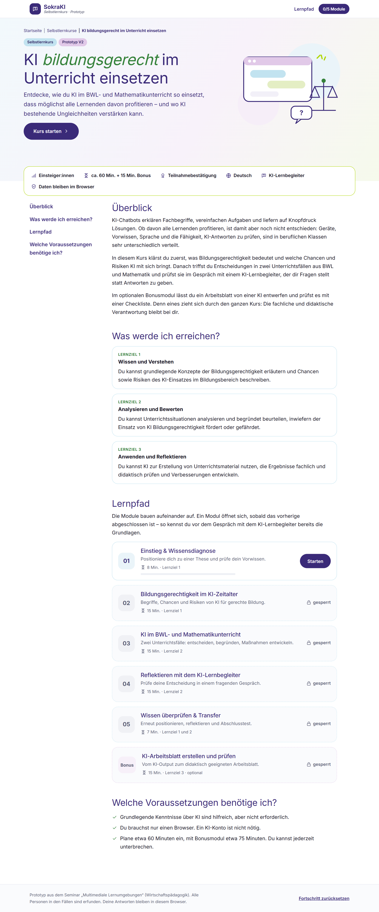
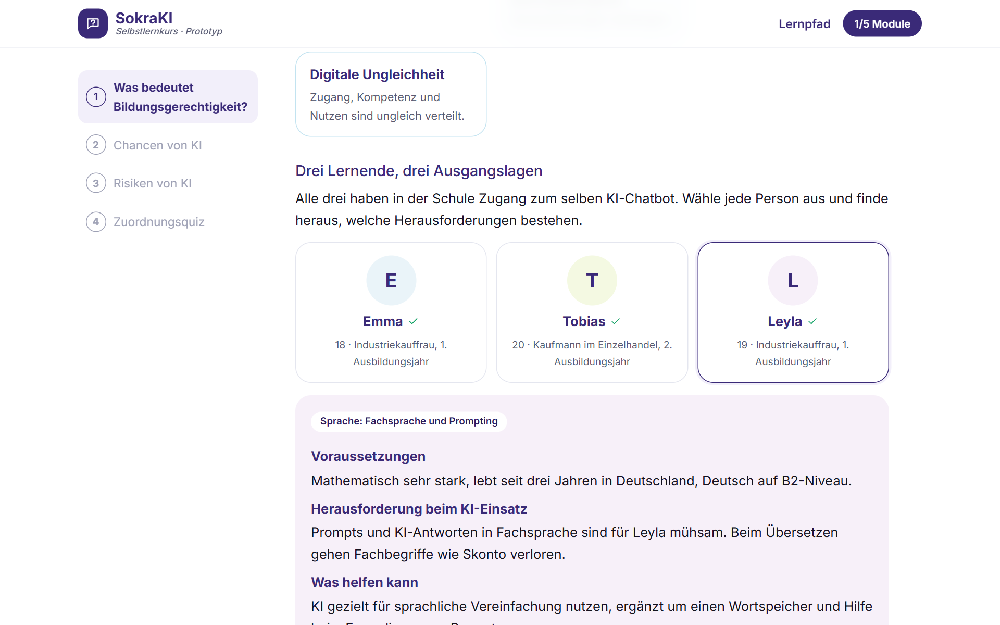
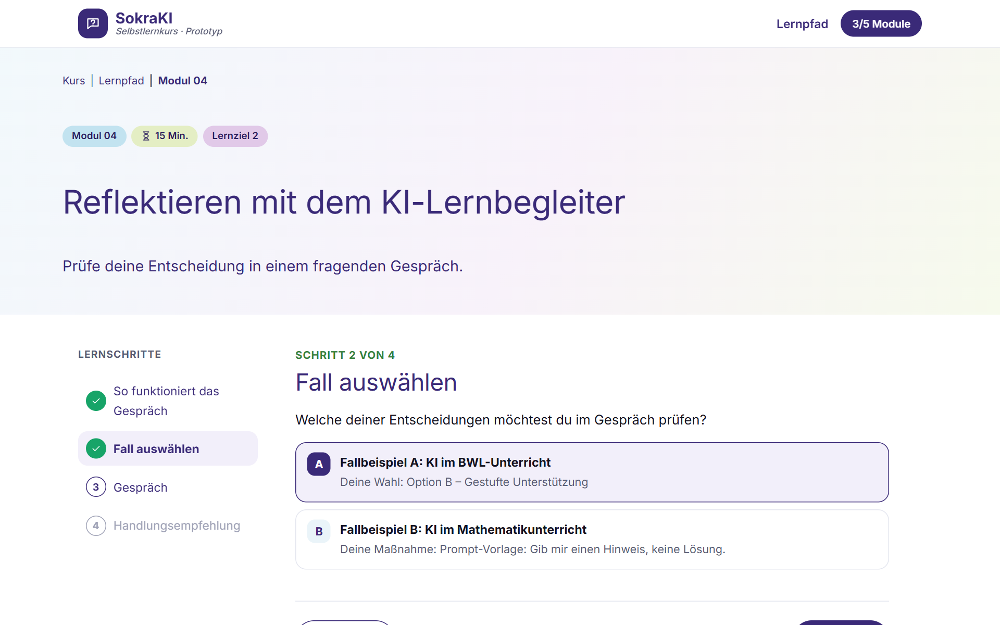

# KI bildungsgerecht im Unterricht einsetzen – SokraKI V2

**Ein interaktiver Selbstlernkurs für angehende Lehrkräfte an beruflichen Schulen.**
Prototyp aus dem Seminar *Multimediale Lernumgebungen* (Wirtschaftspädagogik). Bearbeitungsdauer: ca. 60 Minuten, mit Bonusmodul ca. 75 Minuten.



---

## Schnellstart in 5 Schritten

Du brauchst keine Programmierkenntnisse. Rechne beim ersten Mal mit etwa 10 Minuten.

### 1. Node.js installieren (einmalig)

Lade Node.js in der Version **LTS** von [nodejs.org](https://nodejs.org/de) herunter und installiere es mit den Standardeinstellungen (mindestens Version 20.9). Öffne danach ein **neues** Terminal und prüfe:

```bash
node -v
```

> **Terminal öffnen:** Unter Windows im Startmenü „Eingabeaufforderung“ suchen, unter macOS das Programm „Terminal“ öffnen.

### 2. Projekt herunterladen

**Mit Git:**

```bash
git clone https://github.com/1MauriceWolfrum-tech/SokraKI-V2.git
```

```bash
cd SokraKI-V2
```

**Ohne Git:** Auf [github.com/1MauriceWolfrum-tech/SokraKI-V2](https://github.com/1MauriceWolfrum-tech/SokraKI-V2) auf **Code → Download ZIP** klicken, entpacken und im Terminal in den Ordner wechseln, zum Beispiel `cd Downloads/SokraKI-V2-main`.

### 3. Abhängigkeiten installieren (einmalig, ca. 1 Minute)

```bash
npm install
```

### 4. Kurs starten

```bash
npm run dev
```

### 5. Im Browser öffnen

Öffne **[http://localhost:3000](http://localhost:3000)**. Beenden mit **Strg + C** im Terminal.

> **Port 3000 belegt?** `npm run dev -- -p 3001` und `http://localhost:3001` öffnen.

---

## Aufbau des Kurses

| Modul | Titel | Dauer | Lernziel |
| --- | --- | --- | --- |
| 01 | Einstieg & Wissensdiagnose | 8 Min. | Vorwissen aktivieren, Position zur Ausgangsthese |
| 02 | Bildungsgerechtigkeit im KI-Zeitalter | 15 Min. | Begriffe, Chancen, Risiken, Zuordnungsquiz |
| 03 | KI im BWL- und Mathematikunterricht | 15 Min. | Zwei Unterrichtsfälle: entscheiden, begründen, Maßnahmen |
| 04 | Reflektieren mit dem KI-Lernbegleiter | 15 Min. | KI-gestützte sokratische Gesprächsführung in fünf Phasen |
| 05 | Wissen überprüfen & Transfer | 7 Min. | Erneute Positionierung, Reflexion, Abschlusstest, Feedback |
| Bonus | KI-Arbeitsblatt erstellen und prüfen | 15 Min. | Entwurf mit Checkliste prüfen und verbessern |

Die Module schalten sich nacheinander frei. Nach Modul 05 gibt es eine druckbare Teilnahmebestätigung; das Bonusmodul ist optional.



**Aufgabenteilung zwischen Inhalten und KI:** Wissensvermittlung und Wissensüberprüfung stammen aus den selbst erstellten Kursinhalten. Die KI übernimmt nur zwei klar abgegrenzte Rollen: den Lernbegleiter in Modul 04 und optional den Arbeitsblatt-Entwurf im Bonusmodul.

---

## Der KI-Lernbegleiter



Das Gespräch folgt einem selbst entwickelten Leitfaden mit fünf Phasen: **Position klären → Annahmen hinterfragen → Perspektiven erweitern → Konsequenzen prüfen → Reflexion abschließen.** Die App legt die Phase fest, nicht das Sprachmodell. Ist eine Antwort knapp (unter 60 Zeichen oder ohne erkennbare Begründung), fragt der Lernbegleiter einmal nach.

| Modus | Einstellung | Kosten |
| --- | --- | --- |
| Leitfaden (Standard) | `KI_MODUS=skript` | keine – Fragen kommen aus dem Leitfaden, Arbeitsblätter sind vorbereitet |
| KI | `KI_MODUS=claude` | nach Verbrauch der Claude API |

Für den KI-Modus `.env.example` nach `.env.local` kopieren, `KI_MODUS=claude` setzen und den API-Schlüssel bei `ANTHROPIC_API_KEY` eintragen. Im KI-Modus gilt:

- Claude formuliert die Frage der jeweiligen Phase und greift die letzte Antwort auf.
- Jede Frage wird geprüft: genau eine Frage, höchstens vier Sätze, keine Gefühlsbekundungen. Bei einem Verstoß folgt ein zweiter Versuch, danach übernimmt der Leitfaden.
- Ohne Zugang oder bei Fehlern läuft der Kurs automatisch im Leitfaden-Modus weiter.
- Modell `claude-opus-5-5` mit geringer Denktiefe (`KI_EFFORT=low`). Lehnt das Modell eine Anfrage ab, beantwortet sie ein Rückfallmodell.

---

## Inhalte überarbeiten

Alle Texte stehen in `lib/inhalte/` und sind als **Entwurfstexte** markiert. Bitte überarbeitet sie und belegt Begriffe in der Hausarbeit mit Literatur.

| Datei | Inhalt |
| --- | --- |
| `kurs.ts` | Titel, Überblick, Lernziele, Module, Voraussetzungen |
| `modul1.ts` | Ausgangsthese, Skala, Wissensdiagnose mit Feedback |
| `modul2.ts` | Begriffe, drei Lernende, Chancen, Risiken, Zuordnungsquiz, Literatur |
| `modul3.ts` | Fall A (Angebotsvergleich), Fall B (lineare Kostenfunktionen), Impulse |
| `modul4.ts` | Gesprächsphasen, Regeln, Leitfaden-Fragen |
| `modul5.ts` | Reflexionsfragen, Kriterien einer guten Begründung, Abschlusstest, Feedback |
| `bonus.ts` | Themen, Prompt-Vorlagen, vorbereitete Entwürfe, Schwachstellen, Checkliste |

Weitere wichtige Dateien: `components/module/` (Lernschritte je Modul und ihre Abschlussbedingungen), `lib/lernbegleiter/phasen.ts` (Gesprächssteuerung), `lib/ki/` (Claude-Anbindung), `app/api/` (Schnittstellen), `app/globals.css` (Design).

Vor einem Push prüfen:

```bash
npm run typecheck
```

```bash
npm run build
```

---

## Datenschutz und Sicherheit

**Bitte keine echten Schülerdaten eingeben.** Alle Personen in den Fällen sind erfunden.

| Thema | So ist es gelöst |
| --- | --- |
| Speicherung | Antworten und Fortschritt liegen nur im Browser (`localStorage`). Keine Datenbank, kein Konto, kein Tracking, keine Cookies. |
| Kursfeedback | Wird nur als Datei gespeichert, wenn die Person das selbst auslöst. |
| Schriftart | Wird lokal eingebunden – keine Verbindung zu Google beim Aufruf. |
| Leitfaden-Modus | Keine Daten verlassen den Rechner. |
| KI-Modus | Gesprächstexte und Arbeitsaufträge gehen an die Claude API von Anthropic. Für den Einsatz mit Studierenden vorher Datenschutz klären. |
| API-Schlüssel | Nur in `.env.local`, die Git ignoriert. |
| Erreichbarkeit | `npm run dev` ist nur auf dem eigenen Rechner erreichbar; `npm run dev:netzwerk` öffnet die App im WLAN – nicht im KI-Modus verwenden. |
| Schnittstellen | Prüfen Struktur und Länge jeder Anfrage und setzen Sicherheits-Header. |

## Häufige Probleme

| Problem | Lösung |
| --- | --- |
| `node` oder `npm` wird nicht gefunden | Node.js installieren und ein **neues** Terminal öffnen. |
| PowerShell meldet, `npm.ps1` könne nicht geladen werden | Die **Eingabeaufforderung** (cmd) verwenden. |
| Port 3000 ist belegt | `npm run dev -- -p 3001` |
| Nach `git pull` startet die App nicht | `npm install` erneut ausführen. |
| Ein Modul ist gesperrt | Erst das vorherige Modul abschließen. Zum Testen: unten „Fortschritt zurücksetzen“. |

## Technik

Next.js 16, React 19, TypeScript, Anthropic SDK. Design angelehnt an die ruhige Gestaltung etablierter Lernplattformen: viel Weißraum, Violett als Leitfarbe, Pastellakzente.
